# DeskPilot: Enterprise Service Desk & Request Management Platform

[](https://github.com/dipti-226/Smart-Service-Request-Management/actions/workflows/deploy.yml)

DeskPilot is a full-stack service desk where employees raise service requests, admins assign them to the right technician, and technicians work them through to resolution. Every change is tracked in a status timeline, requests carry comments, and optional AI features help write, classify and summarise requests.

**Live demo:** https://deskpilot.runasp.net

> The demo runs on a free hosting tier with limited resources. The first request after a period of inactivity can take a few seconds while the app wakes up. Demo accounts for the Admin, Employee and Technician roles are available on request.

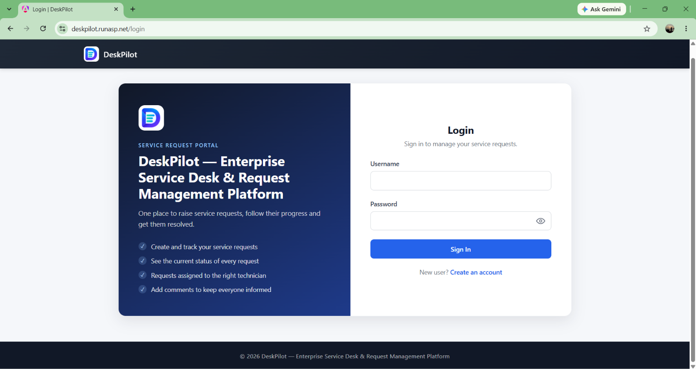

## Features

**Roles and workflow**
- Three roles with separate permissions: **Admin**, **Employee** and **Technician**.
- Employees create and track their own requests and can edit them while they are still *Open*.
- Admins see every request, assign technicians, change status, and manage users.
- Technicians see only the requests assigned to them and move them forward.
- Request lifecycle: `Open → In Progress → On Hold / Resolved → Closed`, plus `Cancelled` and re-open. Allowed moves are stored in a database table per role, so the rules live in one place.
- Full status history (who changed what, when, with which role) shown as a timeline.
- Comments on every request, visible only to the people allowed to see that request.

**Productivity**
- Search, status and priority filters, sorting and pagination.
- CSV export of requests.
- Dashboard with status counts, a status chart and recent requests.
- Admin user management: create technicians, activate and deactivate accounts.
- Technician profiles with specializations.
- Technician workload limit (maximum 3 active requests) and a **recommended technician** based on specialization and current workload.
- Responsive layout that works on phones.

**AI assistance (optional, can be switched off)**
- Suggest request type and priority from the description.
- Improve a description and list the details a technician will probably need.
- Quick fixes to try before submitting a request.
- Request summary with blockers and a suggested next step.
- Reply drafts for comments.
- Technician second opinion for assignment.
- Groq is the primary provider and Gemini the alternative. The application works fully with AI disabled, and AI failures never block normal request handling.

## Screenshots

| | |
|---|---|
| 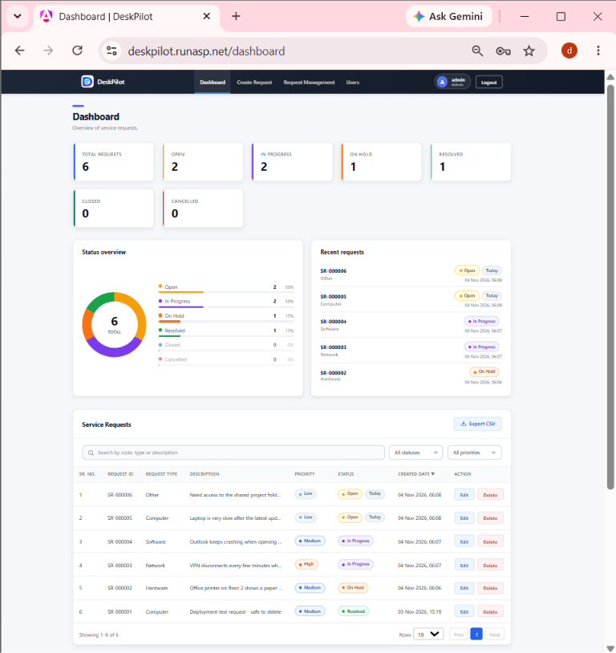 | 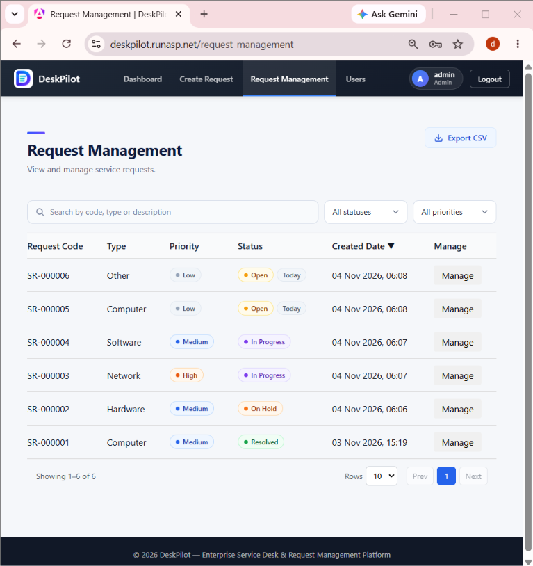 |
| **Admin dashboard** | **Request management** |
| 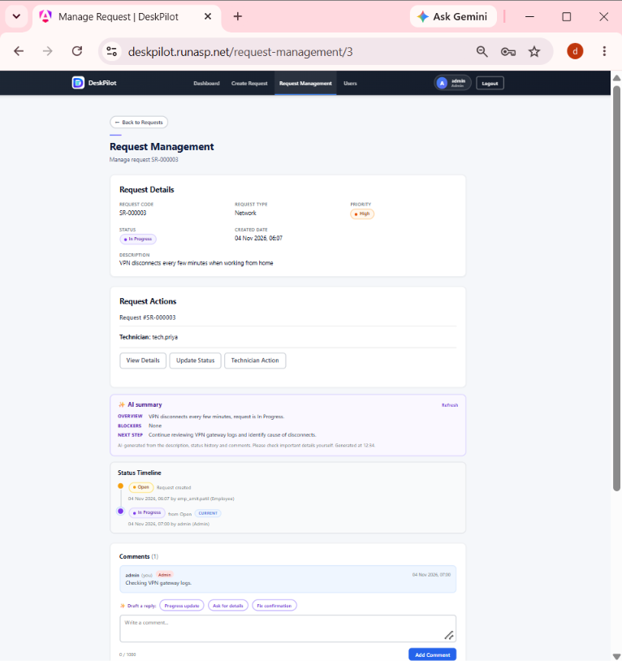 | 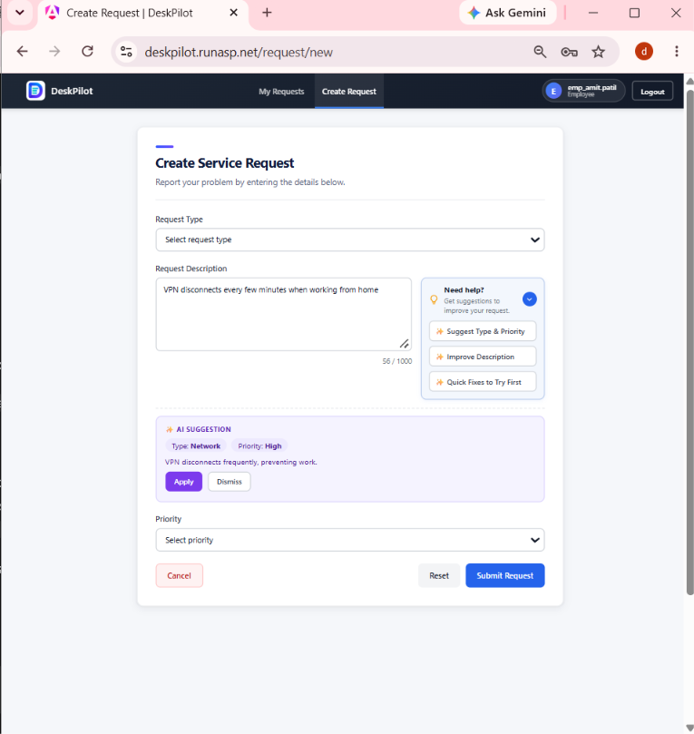 |
| **Request details: timeline, comments, AI summary** | **Create request with AI suggestions** |
| 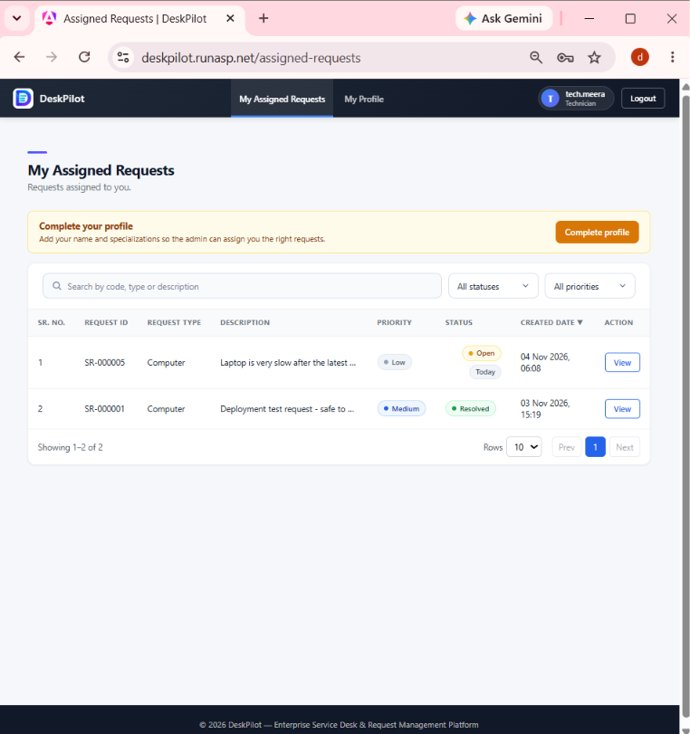 | 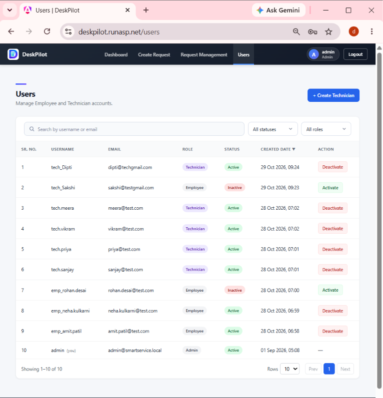 |
| **Technician: assigned requests** | **Admin: user management** |

**Mobile**

<p>
  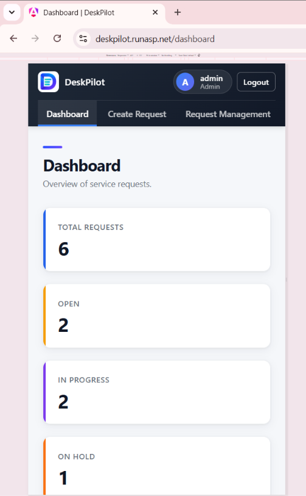
  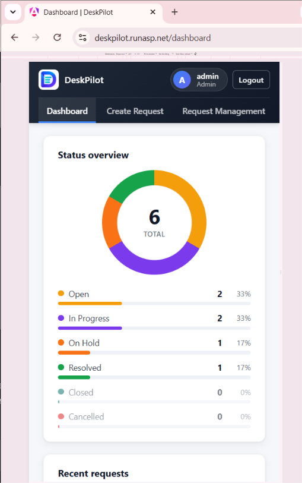
  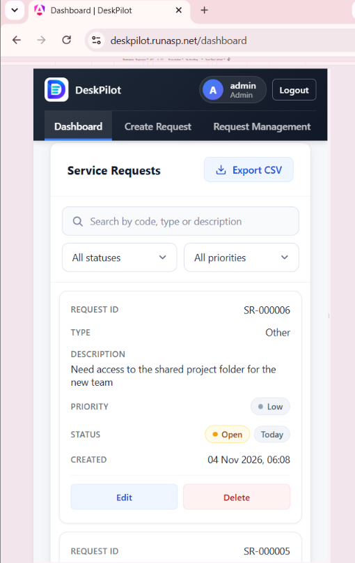
</p>

## Technology stack

| Layer | Technology |
|---|---|
| Frontend | Angular 21, standalone components, Signals, zoneless change detection, TypeScript, HTML, CSS |
| Backend | ASP.NET Core Web API on .NET 9, C#, ADO.NET |
| Database | SQL Server, stored procedures |
| Authentication | JWT bearer tokens, ASP.NET Core Identity password hasher |
| AI | Groq (primary) and Gemini (alternative), configurable |
| CI/CD | GitHub Actions, Web Deploy |
| Hosting | MonsterASP.NET Free (Windows Server, IIS), SQL Server 2025 |

## Architecture

The Angular application is built in CI and served by the same ASP.NET Core application, so the browser talks to a single origin and no CORS configuration is needed in production.

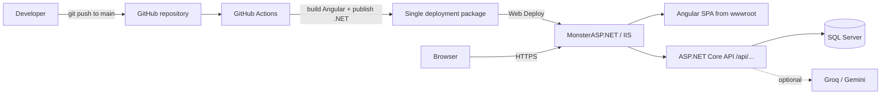

Routing in production:

| Request | Handled by |
|---|---|
| `/`, `/login`, `/dashboard` and other pages | Angular app (SPA fallback to `index.html`) |
| `/api/...` | ASP.NET Core API |
| Unknown `/api/...` | API 404 in the standard `{ success, message, errorCode }` shape |
| `/health` | Health endpoint |

Backend layers:

```
API/
├── APP.API        Controllers, middleware, authentication, rate limiting
├── APP.Business   Services and AI clients
├── APP.Common     Shared helpers and response models
├── APP.Models     DTOs and validation rules
└── DBScript       Database scripts
Web/
└── smart-service-request   Angular application
```

## Security

- **Passwords** are stored only as salted hashes (ASP.NET Core Identity password hasher). They are never returned by any API.
- **JWT authentication** with issuer, audience and lifetime validation. The signing key must be supplied through configuration; the app refuses to start without a key of at least 32 bytes.
- **Role-based access** is enforced in the API and again inside the stored procedures: employees only reach their own requests, technicians only requests assigned to them.
- **Account lockout** after 5 failed sign-ins for 15 minutes.
- **Rate limiting** per client IP on login, registration and the AI endpoints.
- **SQL injection protection:** all data access goes through parameterised stored procedures; sorting uses a whitelist instead of dynamic SQL, and `LIKE` search input is escaped.
- **Safe concurrent updates:** status changes check the current status inside the update, so two people acting at the same moment cannot skip a workflow step. Technician assignment locks the technician's row, so the workload limit cannot be exceeded by two simultaneous assignments.
- **AI usage limits:** per-user and total daily caps, plus a request timeout.
- **Secrets are never committed.** Connection strings and keys are supplied through environment variables in production and .NET user-secrets locally.
- HTTPS is enabled on the live site.

## Deployment and CI/CD

Every push to `main` deploys automatically through [GitHub Actions](.github/workflows/deploy.yml):

1. Check out the code and set up Node.js 24 and the .NET 9 SDK.
2. `npm ci` and a production Angular build.
3. Copy the Angular output into the API's `wwwroot` and fail if it is missing.
4. `dotnet publish` (Release, `win-x86`, framework-dependent) and verify the output contains the application, `web.config` and the Angular files.
5. Deploy the package to MonsterASP.NET with Web Deploy, using credentials stored as GitHub repository secrets.

Runs are serialised with a concurrency group, so two deployments never overlap, and the workflow only has read access to the repository. Production settings (database connection, JWT key, AI switch and API key) are environment variables in the hosting control panel.

Database changes are applied manually and in order, using SQL scripts that live in `API/DBScript`, before the code that depends on them is pushed.

## Run locally

**Prerequisites:** .NET 9 SDK, Node.js 24 with npm, Angular CLI 21, SQL Server (Express is enough).

1. **Database:** create an empty database and run the scripts in `API/DBScript`.
2. **API configuration** (values are examples; use your own and never commit them):
   ```bash
   cd API/APP.API
   dotnet user-secrets set "ConnectionStrings:DefaultConnection" "<your SQL Server connection string>"
   dotnet user-secrets set "Jwt:Key" "<a random string of at least 32 characters>"
   ```
   AI is off by default. To try it, set `Ai:Enabled` to `true` and add `Ai:Groq:ApiKey`.
3. **Run the API** (`https://localhost:7268`):
   ```bash
   dotnet run --project API/APP.API --launch-profile https
   ```
4. **Run the Angular app** (`http://localhost:4200`):
   ```bash
   cd Web/smart-service-request
   npm ci
   npx ng serve
   ```

## Free-hosting limitations

The live demo is a portfolio deployment on a free tier: about 256 MB of RAM, a 1 GB database, a single EU datacenter and no service-level guarantee. The app can pause when idle and start slowly on the next visit, and the free plan does not include automatic database backups, so backups are taken manually. It is not intended to hold real users' sensitive data.

## Planned improvements

- Automatic sign-out and redirect to the login page when a session expires.
- Automated database migrations in the pipeline.
- Better production logging.
- Dependency vulnerability review and updates.
